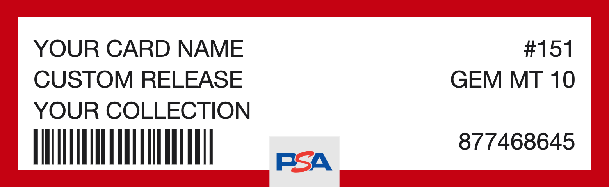

# Graded Card Label Generator

A static web page that generates graded-card style labels in a **PSA** or **CGC** layout and exports them as PNG or PDF. No build step or server required.

## Running it

Open `index.html` in a browser. To host it, publish the folder as-is (for example with GitHub Pages).

PDF export loads [jsPDF](https://github.com/parallax/jsPDF) from a CDN, so an internet connection is needed for PDFs.

## Using it

1. Choose a **Style** with the PSA / CGC switch at the top. Pick this first, since it changes which fields are shown and resets the default border color and size.
2. Fill in the form. Only **Title 1** is required; blank fields use the defaults shown as placeholders.

   | Section | Field | Notes |
   | --- | --- | --- |
   | Content | Title 1, 2, 3 | Left side of the label. |
   | | Grading agency | CGC only. Header text, defaults to `CERTIFIED GUARANTY COMPANY`. |
   | | Number | PSA only. Pre-filled with a random `#1`–`#1000`. |
   | | Grade | PSA: free text, defaults to `GEM MT 10`. CGC: a whole number 0–10, defaults to 10. |
   | | Autograph | PSA only. Optional. |
   | | Audit number | Pre-filled with a random 9-digit number. |
   | Format | Border color | PSA: `#C50212`. CGC: `#000022`. |
   | | Background color | Defaults to `#FFFFFF`. Text switches to light on dark backgrounds. |
   | | Logo | Upload an image to replace the style's default logo. |
   | Size | Width / Height (mm) | PSA: 65 × 20. CGC: 65 × 26. |

3. Click **Generate** to preview the label. Number and audit number get a new random value on each press, unless you typed your own.
4. Use the buttons under the preview to download:
   - **PNG**: the label only, no margins, at about 610 dpi.
   - **PDF**: choose a paper size (3×5, 4×6, 5×7 or letter) and whether to add 0.25 in margins. The page is landscape and the label is placed top-left at its real size. If it is too large for the page, it is scaled down to fit.

## Styles

### PSA

- Border color frames the label; background color fills the inside.
- Titles are on the left. Number, grade, autograph and audit number are on the right.
- A fake barcode sits under Title 3, and the logo sits in a gray box at bottom center.
- Text is converted to uppercase.

### CGC

- Border color fills the outer frame and the header strip; background color fills the text box.
- The header strip has the logo at top left (white by default; recolored dark if the border is light) and the grading agency right-aligned.
- Titles are bold and keep the capitalization you type.
- The fake barcode and audit number run along the bottom of the text box.
- A divider separates the titles from the grade, which is shown large with its grade name above it:

  | Grade | Name | Grade | Name |
  | --- | --- | --- | --- |
  | 10 | GEM MINT | 4 | VG/EX |
  | 9 | MINT | 3 | VERY GOOD |
  | 8 | NM/MT | 2 | GOOD |
  | 7 | NEAR MINT | 1 | POOR |
  | 6 | EX/NM | 0 | NO GRADE |
  | 5 | EXCELLENT | | |

## Files

- `index.html`: page markup
- `style.css`: styles
- `app.js`: form handling, label rendering and export
- `default-logo.js`: the default logo, embedded as a data URI so export works when opened from `file://`
- `psa_logo.png`, `cgc_logo.png`: source images for the default logos (the CGC one is white on transparent)
- `example_label.png`: example output shown in this README
